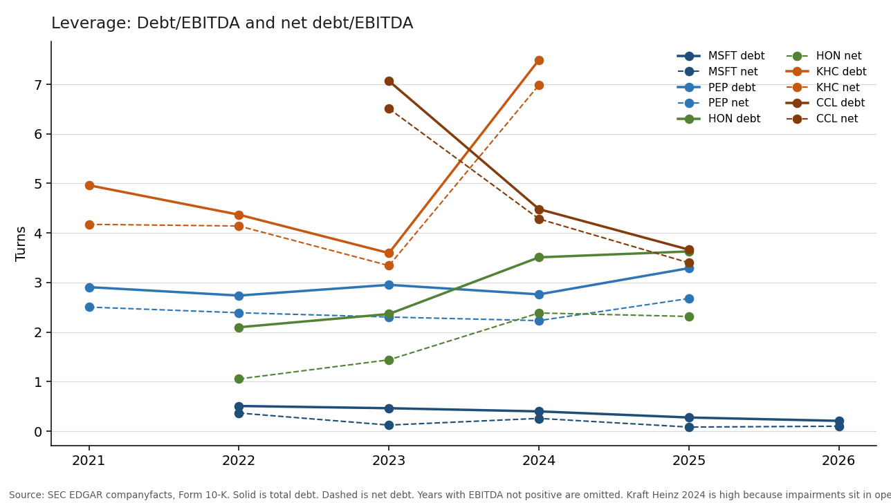
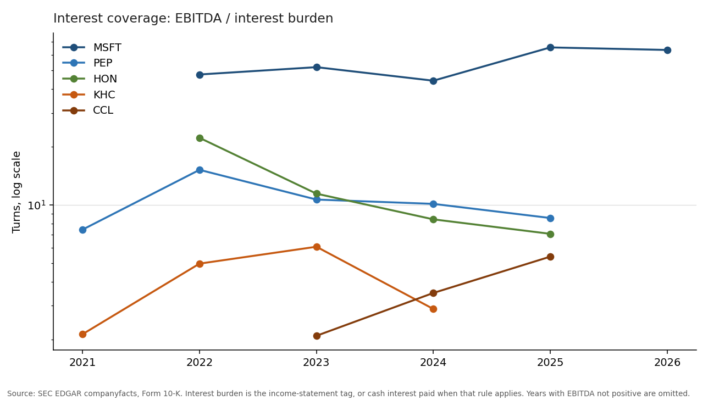
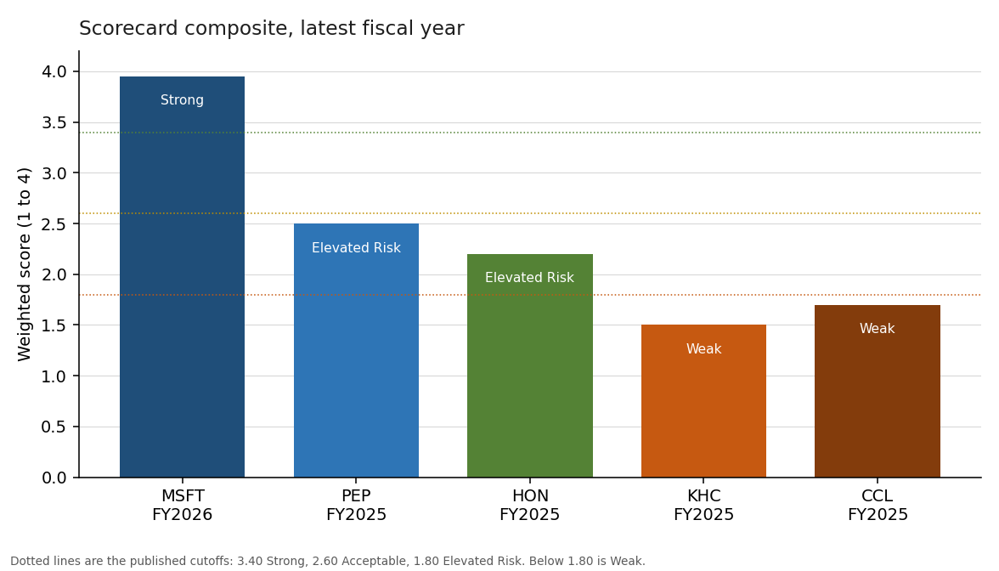

# Corporate credit analysis and term-loan underwriting

Vanuja Ekanayake, BBA Finance candidate, Baruch College Zicklin School of Business.

This file applies one set of credit definitions to five US non-financial registrants and then sizes a term loan for a borrower that is not real. The public-company figures come from Form 10-K facts on EDGAR. The loan is labeled FICTIONAL in the data file, in the workbook, and in the memo. There is no statistical model and no undisclosed adjustment.

## Objective

The question is the usual one in a credit file. How much debt is there, what cash flow covers it, and where does a proposed loan sit relative to a leverage limit and a debt-service limit. The same arithmetic is used for a software company with little funded debt, a staples company that runs with current liabilities above current assets, an industrial issuer that has been issuing notes, a packaged-food company whose latest operating income is after a large impairment, and a cruise operator whose leverage is still high after the pandemic.

## Why these five

| Issuer | Business | Why it is in the file |
| --- | --- | --- |
| Microsoft Corporation | Software and cloud services | Funded leverage is a fraction of a turn and interest coverage is very high. This is the strong end of the set. |
| PepsiCo, Inc. | Beverages and convenient foods | Stable consumer cash flow, Debt/EBITDA a little above 3x, coverage still in the top bucket of the scale below. |
| Honeywell International Inc. | Diversified industrials | The fiscal 2025 Form 10-K discloses long-term ratings of A (S&P), A (Fitch), and A2 (Moody's). Leverage stepped up with note issuance. |
| The Kraft Heinz Company | Packaged foods | The fiscal 2025 Form 10-K discloses BBB / BBB / Baa2. Operating income is negative after $9.3 billion of impairment losses. The scorecard does not add those losses back. |
| Carnival Corporation & plc | Cruise and leisure | EBITDA has recovered. Funded debt has not come down to the level of the other four. This is the leveraged end of the set. |

No banks or finance companies are included. Captive-finance debt would mix an operating company with a funding vehicle, and the debt tags would not mean the same thing. Agency ratings are quoted only where the Form 10-K states them. The scorecard result is not a rating.

## Definitions

Each ratio is defined once, in `src/ratios.py`, and every sheet uses that function.

**EBITDA.** Operating income plus depreciation and amortization. Depreciation and amortization is taken from `DepreciationDepletionAndAmortization` if that annual fact exists, otherwise `DepreciationAndAmortization`, otherwise depreciation plus amortization of intangible assets. The cash-flow line "depreciation, amortization, and other" is not used when it contains amounts beyond depreciation and amortization. Impairments, stock-based compensation, and restructuring are not added back.

**Gross margin.** Gross profit divided by revenue. Gross profit is the reported gross-profit fact when the annual fact exists. Otherwise it is revenue minus cost of revenue.

**EBITDA margin.** EBITDA divided by revenue.

**Total debt.** Short-term borrowings plus the current portion of long-term debt plus long-term debt. Operating lease liabilities are not added. Finance lease liabilities are not added. When the only long-term debt tags are the combined debt-and-capital-lease concepts, the finance lease liability is subtracted. When the debt tags do not contain finance leases, nothing is subtracted.

**Net debt.** Total debt minus cash and cash equivalents. Short-term investments and other marketable securities are not deducted.

**Debt / EBITDA.** Total debt divided by EBITDA. Not meaningful when EBITDA is not positive.

**Net debt / EBITDA.** Net debt divided by EBITDA. Not meaningful when EBITDA is not positive. A negative result is a net cash position.

**Interest burden.** The income-statement fact, in this order: `InterestExpenseNonoperating`, `InterestAndDebtExpense`, `InterestExpense`, `InterestExpenseDebt`. If the fact used is the generic `InterestExpense` tag and cash interest paid exceeds it by more than 25 percent, coverage uses cash interest paid. That rule is there because some issuers tag a net interest-and-other line as `InterestExpense`. PepsiCo is that case. Cash interest paid is `InterestPaid`, or `InterestPaidNet` when `InterestPaid` is absent.

**EBITDA / Interest.** EBITDA divided by the interest burden.

**(EBITDA − capex) / Interest.** The same interest burden. Capital expenditure is `PaymentsToAcquirePropertyPlantAndEquipment`, or `PaymentsToAcquireProductiveAssets` when the first tag is absent. A payments tag reported with a negative sign is stored as a positive cash outflow.

**CFO / Debt.** Net cash from operating activities divided by total debt.

**Current ratio.** Current assets divided by current liabilities.

**Quick ratio.** (Current assets minus inventory) divided by current liabilities. Prepaids and other current assets stay in the numerator. The quick ratio is reported. It is not a separate line in the scorecard. The current ratio is the liquidity line that is scored.

**Debt / capitalization.** Total debt divided by (total debt plus the parent's stockholders' equity). Noncontrolling interest is not added.

**Free cash flow.** Net cash from operating activities minus capital expenditure.

**Debt service coverage, underwriting only.** (EBITDA minus maintenance capex minus cash taxes) divided by (cash interest plus scheduled principal). Cash taxes are the cash-tax assumption, not a tax provision. Scheduled principal on the term loan is the original commitment divided by the tenor. This ratio is not computed for the SEC issuers, because scheduled principal is not a single 10-K line.

## Scorecard

Weights, bucket bounds, and category cutoffs are published in `config/scorecard.yaml`. A lower-is-better ratio takes the first bucket whose maximum is greater than or equal to the value. A higher-is-better ratio takes the first bucket whose minimum is less than or equal to the value. The bound is inclusive, so 1.50x Debt/EBITDA is in the top bucket, and 1.51x is in the next one.

Points are 4, 3, 2, and 1. The composite is the weighted average. If a ratio cannot be computed because an input is missing, its weight is spread across the ratios that were scored. A ratio that is not meaningful is still scored, usually in the bottom bucket, and the contribution table says why.

| Ratio | Weight | 4 points | 3 points | 2 points | 1 point |
| --- | ---: | --- | --- | --- | --- |
| Debt / EBITDA | 20% | at or below 1.50x | at or below 2.50x | at or below 3.50x | above 3.50x |
| Net debt / EBITDA | 15% | at or below 0.50x | at or below 1.50x | at or below 3.00x | above 3.00x |
| EBITDA / Interest | 20% | at or above 8.00x | at or above 4.00x | at or above 2.00x | below 2.00x |
| (EBITDA − capex) / Interest | 10% | at or above 6.00x | at or above 3.00x | at or above 1.50x | below 1.50x |
| CFO / Debt | 15% | at or above 40% | at or above 25% | at or above 15% | below 15% |
| FCF / Debt | 5% | at or above 20% | at or above 10% | at or above 0% | negative |
| Debt / capitalization | 10% | at or below 25% | at or below 40% | at or below 55% | above 55% |
| Current ratio | 5% | at or above 1.50x | at or above 1.20x | at or above 1.00x | below 1.00x |

| Composite | Result |
| --- | --- |
| 3.40 to 4.00 | Strong |
| 2.60 to 3.39 | Acceptable |
| 1.80 to 2.59 | Elevated Risk |
| below 1.80 | Weak |

Special cases, also in the yaml:

- EBITDA not positive: Debt/EBITDA and Net Debt/EBITDA score 1. The multiple is not shown.
- Interest zero or negative, and EBITDA positive: both coverage ratios score 4. Coverage is not a constraint. If EBITDA is also not positive, they score 1.
- Total debt zero and cash flow positive: CFO/Debt and FCF/Debt score 4.

The contribution table in `reports/credit_analysis.xlsx` and in each memo shows the value, the weight, the points, and the note. That is the whole trail from the ratio to the result.

## Data

Facts are read from the SEC companyfacts endpoint:

`https://data.sec.gov/api/xbrl/companyfacts/CIK##########.json`

The request sends the User-Agent `corporate-credit-analysis research Vanuja-E`. It does not contain an email address or a phone number. The SEC edge rejects a User-Agent that contains `github.com`, so the header does not include a URL. Requests are spaced. The raw JSON is cached in `data/raw/`. A later run uses the cache unless `--refresh` is passed. Tests do not call the network.

Only Form 10-K facts with fiscal period FY are kept. A flow fact has to cover about a year, between 300 and 380 days, so a quarterly fact tagged as FY is dropped. Amendments filed on Form 10-K/A are not used. For a given period end, the copy in the latest 10-K is kept. A comparative column in a later 10-K replaces the original column. The accession on each line in `data/processed/lineage.csv` is the filing that supplied the number. The tag used for each figure is in that file.

The fiscal year label is the calendar year of the period end. Microsoft's year ended June 30, 2026 is fiscal 2026. PepsiCo's year ended December 27, 2025 is fiscal 2025. The window is the latest five fiscal years from 2021 on. Honeywell's companyfacts feed does not tag operating income for fiscal 2021, so EBITDA for Honeywell starts in fiscal 2022. Revenue for that year is still in the extract.

These are the Form 10-K documents for the years in the file. A figure for an earlier year may be cited to a later 10-K when that later filing reports the comparative column.

| Issuer | Fiscal year end | Filed | Form 10-K |
| --- | --- | --- | --- |
| Microsoft | 2022-06-30 | 2022-07-28 | https://www.sec.gov/Archives/edgar/data/789019/000156459022026876/msft-10k_20220630.htm |
| Microsoft | 2023-06-30 | 2023-07-27 | https://www.sec.gov/Archives/edgar/data/789019/000095017023035122/msft-20230630.htm |
| Microsoft | 2024-06-30 | 2024-07-30 | https://www.sec.gov/Archives/edgar/data/789019/000095017024087843/msft-20240630.htm |
| Microsoft | 2025-06-30 | 2025-07-30 | https://www.sec.gov/Archives/edgar/data/789019/000095017025100235/msft-20250630.htm |
| Microsoft | 2026-06-30 | 2026-07-29 | https://www.sec.gov/Archives/edgar/data/789019/000119312526323660/msft-20260630.htm |
| PepsiCo | 2021-12-25 | 2022-02-10 | https://www.sec.gov/Archives/edgar/data/77476/000007747622000010/pep-20211225.htm |
| PepsiCo | 2022-12-31 | 2023-02-09 | https://www.sec.gov/Archives/edgar/data/77476/000007747623000007/pep-20221231.htm |
| PepsiCo | 2023-12-30 | 2024-02-09 | https://www.sec.gov/Archives/edgar/data/77476/000007747624000008/pep-20231230.htm |
| PepsiCo | 2024-12-28 | 2025-02-04 | https://www.sec.gov/Archives/edgar/data/77476/000007747625000007/pep-20241228.htm |
| PepsiCo | 2025-12-27 | 2026-02-03 | https://www.sec.gov/Archives/edgar/data/77476/000007747626000007/pep-20251227.htm |
| Honeywell | 2021-12-31 | 2022-02-11 | https://www.sec.gov/Archives/edgar/data/773840/000077384022000018/hon-20211231.htm |
| Honeywell | 2022-12-31 | 2023-02-10 | https://www.sec.gov/Archives/edgar/data/773840/000077384023000013/hon-20221231.htm |
| Honeywell | 2023-12-31 | 2024-02-16 | https://www.sec.gov/Archives/edgar/data/773840/000077384024000014/hon-20231231.htm |
| Honeywell | 2024-12-31 | 2025-02-14 | https://www.sec.gov/Archives/edgar/data/773840/000077384025000010/hon-20241231.htm |
| Honeywell | 2025-12-31 | 2026-02-17 | https://www.sec.gov/Archives/edgar/data/773840/000077384026000013/hon-20251231.htm |
| Kraft Heinz | 2021-12-25 | 2022-02-17 | https://www.sec.gov/Archives/edgar/data/1637459/000163745922000018/khc-20211225.htm |
| Kraft Heinz | 2022-12-31 | 2023-02-16 | https://www.sec.gov/Archives/edgar/data/1637459/000163745923000009/khc-20221231.htm |
| Kraft Heinz | 2023-12-30 | 2024-02-15 | https://www.sec.gov/Archives/edgar/data/1637459/000163745924000018/khc-20231230.htm |
| Kraft Heinz | 2024-12-28 | 2025-02-13 | https://www.sec.gov/Archives/edgar/data/1637459/000163745925000011/khc-20241228.htm |
| Kraft Heinz | 2025-12-27 | 2026-02-12 | https://www.sec.gov/Archives/edgar/data/1637459/000163745926000009/khc-20251227.htm |
| Carnival | 2021-11-30 | 2022-01-27 | https://www.sec.gov/Archives/edgar/data/815097/000081509722000009/ccl-20211130.htm |
| Carnival | 2022-11-30 | 2023-01-27 | https://www.sec.gov/Archives/edgar/data/815097/000081509723000012/ccl-20221130.htm |
| Carnival | 2023-11-30 | 2024-01-26 | https://www.sec.gov/Archives/edgar/data/815097/000081509724000011/ccl-20231130.htm |
| Carnival | 2024-11-30 | 2025-01-27 | https://www.sec.gov/Archives/edgar/data/815097/000081509725000007/ccl-20241130.htm |
| Carnival | 2025-11-30 | 2026-01-27 | https://www.sec.gov/Archives/edgar/data/815097/000081509726000007/ccl-20251130.htm |

The tie-out of model amounts to those filings is in `reports/validation.md`. Microsoft's fiscal 2025 income statement, debt lines, and interest expense were read from the face of the Form 10-K. The other four issuers are the same check on the fiscal 2025 statements.

## Install and run

```bash
pip install -r requirements.txt
python -m src.main
python -m pytest
```

`python -m src.main` rebuilds `data/processed/`, `reports/credit_analysis.xlsx`, the charts, the memos, and `reports/validation.md` from the cache. `python -m src.main --refresh` downloads the companyfacts files again. `python -m pytest` checks the ratio arithmetic, the scorecard edges, the loan schedule, and the FICTIONAL label. It reads fixtures and the cache.

The workbook labels every number as reported, assumption, forecast, or simulated. Company-sheet dollars are millions. The loan sheets are actual dollars.

Memos are in `reports/memos/`. The worked numerical example is also in `notebooks/walkthrough.ipynb`.

## Latest scorecard

| Issuer | Fiscal year | Debt/EBITDA | EBITDA/Interest | Composite | Result |
| --- | ---: | ---: | ---: | ---: | --- |
| Microsoft | 2026 | 0.21x | 63.66x | 3.95 | Strong |
| PepsiCo | 2025 | 3.29x | 8.55x | 2.50 | Elevated Risk |
| Honeywell | 2025 | 3.63x | 7.08x | 2.20 | Elevated Risk |
| Kraft Heinz | 2025 | n.m. | n.m. | 1.50 | Weak |
| Carnival | 2025 | 3.66x | 5.39x | 1.70 | Weak |

n.m. means EBITDA is not positive, so the multiple is not used.

The thresholds are calibrated like a bank's internal scale for middle-market term lending. They are stricter than agency ratings for large-cap issuers. The composite is not a rating. PepsiCo and Honeywell carry A-range agency ratings. An A-rated issuer at about 3.3x Debt/EBITDA scoring Elevated Risk is the expected result on this scale. PepsiCo, at 3.29x, is that case.

PepsiCo's coverage is in the top bucket, at 8.55x, using cash interest paid of $1,748 million rather than the $1,121 million net interest-and-other line. The composite is still Elevated Risk because Debt/EBITDA of 3.29x is above the 2.50x line and the current ratio is below 1. That current ratio is structural for this issuer. Commercial paper and current maturities sit in current liabilities. The scorecard records it at a 5 percent weight rather than ignoring it.

Honeywell's coverage is 7.08x. Debt/EBITDA of 3.63x is past 3.50x, so that line scores in the bottom bucket. The fiscal 2025 10-K describes the note issuance that produced the higher balance. The disclosed A / A / A2 ratings are the issuer's disclosure. They are not an output of this scale.

Kraft Heinz scores Weak because unadjusted EBITDA is negative. The fiscal 2025 Form 10-K presents $9,306 million of impairment losses above operating income. Cash from operations is still positive, at $4,462 million. The memo shows both. Adding the impairment back would be a different calculation, and this file does not do it.

Carnival's coverage has recovered to 5.39x. Debt/EBITDA of 3.66x and debt/capitalization still put the composite below 1.80.



Solid lines are Debt/EBITDA. Dashed lines are net debt/EBITDA. Kraft Heinz fiscal 2024 is high because impairments sit in operating income. Fiscal 2025 is omitted because EBITDA is negative.



Coverage is on a log scale so Microsoft's result does not flatten the other four.



## The FICTIONAL term loan

FICTIONAL Northbridge Precision Components, LLC is not a real company, not an SEC registrant, and not a bank client. Every borrower figure in `data/fictional_northbridge_precision_FICTIONAL.yaml` is an assumption.

The company asks for a $40 million senior secured term loan, five years, 8.50 percent fixed, level principal. EBITDA is $14 million, the sum of $11.4 million of operating income and $2.6 million of depreciation and amortization. Maintenance capex is $1.9 million and cash taxes are $2.1 million, so cash flow available for debt service is $10 million.

The loan is sized to the tighter of a 3.00x leverage cap and a 1.35x DSCR, then rounded down to $100,000. The DSCR test binds. The recommended commitment is $25.9 million. Opening leverage is 1.85x. Year-1 DSCR is 1.35x. The $40 million ask produces a year-1 DSCR of 0.88x and is not approved at that amount.

Covenants are wider than the sizing tests: 3.50x maximum leverage, 2.50x minimum interest coverage, and 1.25x minimum DSCR. Headroom is measured against those covenants. An EBITDA decline of 10 percent, with capex and cash taxes held at the base assumption, takes the DSCR through the 1.25x covenant. Leverage headroom remains. Year 1 is the tightest year because principal is level and interest declines as the balance declines.

The debt roll-forward is opening principal plus draws minus principal repayments. It equals the closing principal in every period, and the final balance is zero.

## Worked example: Microsoft, fiscal 2025

Form 10-K for the year ended June 30, 2025, filed July 30, 2025:

https://www.sec.gov/Archives/edgar/data/789019/000095017025100235/msft-20250630.htm

| Item | Amount ($ millions) |
| --- | ---: |
| Revenue | 281,724 |
| Operating income | 128,528 |
| Depreciation | 22,000 |
| Amortization of intangibles | 6,000 |
| Depreciation and amortization | 28,000 |
| EBITDA | 156,528 |
| Short-term debt | 0 |
| Current portion of long-term debt | 2,999 |
| Long-term debt | 40,152 |
| Total debt | 43,151 |
| Interest expense | 2,385 |

EBITDA = 128,528 + 22,000 + 6,000 = 156,528.

Total debt = 0 + 2,999 + 40,152 = 43,151.

Debt / EBITDA = 43,151 / 156,528 = 0.2757x.

EBITDA / Interest = 156,528 / 2,385 = 65.63x.

The cash-flow line "depreciation, amortization, and other" in that filing is $34,153 million. The $6,153 million difference is the "other" component and is not in EBITDA. Finance lease liabilities of $46,172 million and operating lease liabilities of $22,861 million are excluded from the $43,151 million. Cash is $30,242 million, so net debt is $12,909 million. Short-term investments of $64,323 million are not deducted. The full comparison, including the other four issuers, is in `reports/validation.md`. The same arithmetic is in `notebooks/walkthrough.ipynb`.

## Assumptions and limitations

The thresholds are calibrated like a bank's internal scale for middle-market term lending. They are stricter than agency ratings for large-cap issuers, and the composite is not a rating. PepsiCo and Honeywell carry A-range agency ratings. An A-rated issuer at about 3.3x Debt/EBITDA scoring Elevated Risk is expected under this scale. The cutoffs are a published set of round numbers. They were not fitted to these five issuers. A different set of cutoffs would move PepsiCo and Honeywell between Elevated Risk and Acceptable without changing the underlying statements. The contribution table is there so the result can be taken apart.

Leases are out of debt. That understates leverage where lease liabilities are large. Microsoft's finance leases are larger than its funded debt. Carnival's operating leases are smaller than its funded debt but they are still a claim. Neither is in the ratio.

Net debt ignores short-term investments. For Microsoft that portfolio is larger than funded debt. The memo shows the balance. It does not change the definition.

EBITDA is unadjusted. Kraft Heinz is the case that makes the choice visible. A credit file that adds back non-cash impairments is answering a different question, about cash interest coverage. This file answers the question that was defined, and it shows cash from operations next to the score so the two are not confused.

PepsiCo's income-statement interest tag is a net line. Coverage uses cash interest paid, and both numbers are in the memo. Honeywell's interest line is "interest and other financial charges." Carnival's line is interest expense, net of capitalized interest. The tag used is on each row.

Some facts are rounded in the filing. Microsoft's cash interest paid is tagged in tenths of a billion. Cash interest paid replaces the income-statement interest figure only when the tag is the generic `InterestExpense` concept and cash interest paid exceeds that amount by more than 25 percent. A named tag is kept. Microsoft's interest is tagged `InterestExpenseNonoperating`, so the 25 percent test is not applied and coverage uses the income-statement amount. Cash interest paid is also lower than that amount, $1,500 million against $3,051 million in fiscal 2026, so it would not have replaced the income-statement figure under the test.

The latest 10-K comparative column is the figure of record. Where it was checked against the original filing, as in Microsoft fiscal 2025, the amounts match. A restatement would show up as a difference and would be kept, with the later accession cited.

Five companies is a worked file, not a market sample. The loan is a teaching case with an assumed coupon, an assumed tax bill, and no revolver, no excess cash flow sweep, and no working-capital facility. Downside cases move one variable at a time.

This is not a rating, not a commitment to lend, and not investment advice.
